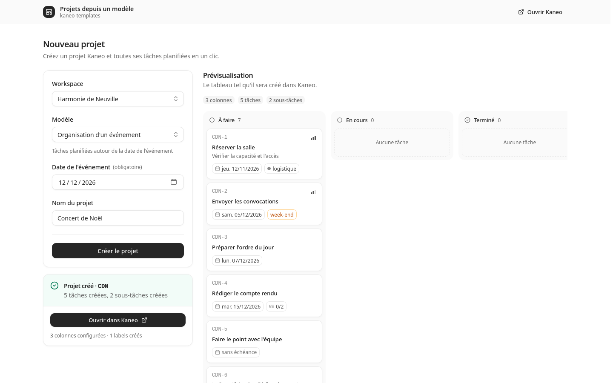

# kaneo-templates

*[Version française](README.fr.md)*

Create a [Kaneo](https://github.com/usekaneo/kaneo) project with its predefined tasks from a YAML template, with due dates computed relative to a project end date.



- Pick a workspace, a template, a project name and an end date; the preview shows the board as Kaneo will create it.
- Due dates before and after the end date: `-30d`, `-5b` (business days), `+3d`, `J-7`…
- Custom columns, priorities, labels (created when missing) and subtasks.
- Two sign-in modes: one service account, or each user with their own Kaneo account (device flow).
- One small container, no database, English and French interface, light and dark themes.

Tested with Kaneo v2.46.2.

## Quick start

```sh
cp .env.example .env    # set KANEO_BASE_URL and KANEO_TOKEN
mkdir templates && cp templates-examples/*.yml templates/
cp docker-compose.example.yml docker-compose.yml
docker compose up -d
```

Open http://127.0.0.1:8000.

**In the default `service` mode the app has no login of its own**: put it behind an authenticating reverse proxy or set `BASIC_AUTH_USER` / `BASIC_AUTH_PASSWORD`. See [docs/deployment.md](docs/deployment.md) for the configuration, the `user` mode and reverse proxy examples.

## Templates

```yaml
version: 1
name: Board meeting
end_date:
  label: Meeting date
columns: [To do, In progress, Done]
tasks:
  - title: Send the invitation
    due: -15d
    priority: high
    labels: [governance]
  - title: Write the minutes
    due: +5b
    subtasks:
      - title: Get them signed
        due: +10b
```

Full reference: [docs/templates.md](docs/templates.md). Examples: [templates-examples/](templates-examples).

## Known limitations

- Business days are Monday to Friday, without public holidays.
- Nothing is rolled back when a creation stops halfway: the report lists what was created and where it stopped.
- Templates are edited as files; there is no editor in the interface.
- Due dates are set at noon UTC; tasks get no assignee.

## Development

Requires [uv](https://docs.astral.sh/uv/).

```sh
uv sync
uv run pytest                  # unit tests, no network
uv run ruff check && uv run ruff format --check
scripts/build-css.sh           # after changing classes in the templates (--watch while editing)
```

Run locally against a Kaneo instance with a `.env` kept outside the repository:

```sh
uv run --env-file ../.env kaneo-templates          # with HOST=127.0.0.1 and TEMPLATES_DIR=templates-examples
uv run --env-file ../.env pytest -m integration    # creates then deletes a throwaway project
```

The stylesheet is built with Tailwind CSS from `src/kaneo_templates/web/tailwind.css` and committed, so running the app needs no front-end tooling. CI checks that it is up to date.

Design notes: [SPEC.md](SPEC.md) (in French), [docs/decisions.md](docs/decisions.md), [docs/kaneo-api-notes.md](docs/kaneo-api-notes.md).

## License

MIT. The Geist font (`static/fonts`) is under the SIL Open Font License, htmx under 0BSD, Lucide icons under ISC.
